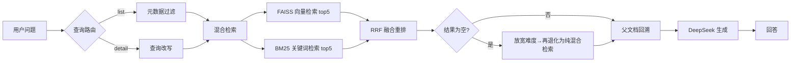

# 今天吃什么 · 食谱 RAG 助手

一个面向「今天吃什么」场景的检索增强问答 Demo：**323 道菜谱 → 结构感知分块 → 混合检索（向量 + BM25 + RRF）→ 元数据过滤与兜底 → DeepSeek 生成**。

项目从开源教程 [datawhalechina/all-in-rag](https://github.com/datawhalechina/all-in-rag) 第 8 章（C8）示例二次开发而来，主要改造集中在**可配置化、检索兜底策略、可复现评测、零依赖 Demo**。

## 为什么要做这个

找菜谱的痛点是「选择困难 + 记不住步骤」：用户要么问「有什么简单的素菜」，要么问「宫保鸡丁怎么做」，两类意图对检索的要求完全不同——前者要**按分类/难度筛选后的列表**，后者要**具体菜品的完整步骤**。

所以这个项目把两类意图分开处理：

| 意图 | 路由 | 检索策略 | 输出 |
| --- | --- | --- | --- |
| 列表型（「有什么简单的素菜」） | `list` | 提取分类/难度作为元数据过滤条件 → 混合检索 → 去重父文档 | 菜品名称列表 |
| 详情型（「宫保鸡丁怎么做」） | `detail` | 混合检索取相关块 → 回溯完整菜谱文档 | 分步骤做法 |

## 架构



代码结构：

```
c8-recipe-rag/
├── config.py              # 全部可配置项，支持环境变量覆盖
├── main.py                # 主流程：路由 → 检索 → 过滤兜底 → 生成
├── rag_modules/
│   ├── data_preparation.py    # Markdown 结构感知分块 + 父子块映射 + 元数据抽取
│   ├── index_construction.py  # FAISS 索引构建/加载（支持本地模型目录）
│   ├── retrieval_optimization.py  # 向量 + BM25 + RRF + 元数据过滤
│   └── generation_integration.py  # 路由、改写、三种回答模式
├── eval/                  # 评测集、评测脚本、对照实验
├── server.py              # 零依赖 Web Demo（标准库 http.server）
├── web/index.html         # 单页前端
└── data/cook/             # 菜谱语料（323 篇 Markdown）
```

## 快速开始

```bash
python -m venv .venv && .\.venv\Scripts\activate    # Windows
pip install -r requirements.txt

cp .env.example .env        # 填入 DEEPSEEK_API_KEY
python main.py              # 命令行交互问答
python server.py            # 浏览器打开 http://127.0.0.1:8000
```

首次启动会构建 FAISS 索引（约 30–60 秒，1764 个块），之后直接加载 `vector_index/`。

嵌入模型默认用 `BAAI/bge-small-zh-v1.5`；如果放在 `models/bge-small-zh-v1.5/` 下会优先用本地目录，避免联网下载。

## 评测

评测集由 `eval/gen_questions.py` 从语料直接生成（15 条详情型 + 6 条列表型，答案可自动判定），跑法：

```bash
python eval/run_eval.py                        # 完整管线
python eval/run_eval.py --no-filter            # 对照组：关闭元数据过滤
```

指标定义：

- `detail_recall@3`：详情型问题中，正确菜品是否出现在检索 top3 里
- `detail_answer_hit`：最终回答里是否包含正确菜品
- `list_category_ok` / `list_difficulty_ok`：列表型问题检索结果的分类/难度是否全部满足用户约束
- `empty_result_rate`：检索返回 0 条的比例（空结果=用户拿不到任何答案）
- `latency_*`：端到端耗时（含一次 LLM 调用）

实测结果（见 `eval/report_*.json`）：

| 配置 | detail_recall@3 | detail_answer_hit | list_category_ok | list_difficulty_ok | empty_result_rate | 平均延迟 |
| --- | --- | --- | --- | --- | --- | --- |
| 纯混合检索（无元数据过滤，对照） | 1.00 | 1.00 | 0.00 | 0.00 | 0.00 | 4.35 s |
| 检索前过滤 + 两级兜底（本项目默认） | 1.00 | 1.00 | 1.00 | 1.00 | 0.00 | 4.52 s |

> 结论：详情型召回两条路线都已饱和（1.00），真正的差距在**列表型问题的约束满足**——不加过滤时用户要「素菜」会把荤菜、汤品一起返回（分类满足率 0.00）；把过滤条件下推到检索层后分类、难度都是 1.00，且空结果率保持 0。
> 迭代记录：最早的版本是「先取 top-k 再过滤」，难度满足率只有 0.50，因为候选池里恰好没有目标难度的文档就被判为无结果；改成「先按元数据筛子集、再在子集内做向量 + BM25」后升到 1.00，端到端延迟几乎没变（4.54 s → 4.52 s）。逐条明细见 [docs/评测报告.md](docs/评测报告.md)。

## 效果示例

```
$ python main.py
您的问题: 有什么简单的素菜推荐？
🎯 查询类型: list
应用过滤条件: {'category': '素菜', 'difficulty': '简单'}
找到 3 个相关文档块: 素炒豆角、鸡蛋羹、蚝油生菜
为您推荐以下菜品：
1. 素炒豆角
2. 鸡蛋羹
3. 蚝油生菜
```


## 主要改造点（相对原示例）

1. **配置外置**：API Key、模型名、base_url、路径、top_k 全部走环境变量，代码里不再出现硬编码密钥（原版把 key 写在 `generation_integration.py` 里）。
2. **过滤下推 + 两级兜底**：元数据过滤从「检索后筛 top-k」改成「先筛子集再检索」，并在候选为空时先放宽难度、再退化为纯混合检索，同时在回答里明确提示"已放宽条件"。
3. **可评测**：生成式评测集 + 无过滤/有过滤双配置对照 + 指标落盘，改动前后用同一口径比较。
4. **本地模型优先**：`models/` 下存在同名目录就用本地权重，弱网环境不用反复下载。
5. **零依赖 Demo**：只用标准库 `http.server` 提供 Web 界面，不需要额外装 fastapi/streamlit。
6. **依赖瘦身**：删掉原 requirements 中未被 import 的 `unstructured`、`Markdown`、`lazy_loader` 等。

## 已知限制

- 元数据（分类/难度）是用文件夹名和「预估烹饪难度」星数解析出来的，不是人工标注，个别菜谱的难度可能不准。
- 详情型检索里「咖喱炒蟹」几乎每次都出现在第 2 位（短文档 + 重复词造成的高相似度），属于典型干扰项，需要引入 rerank 或长度归一化才能压下去。
- 查询改写和路由各消耗一次 LLM 调用，端到端延迟约 4–7 秒；可以合并为一次调用或加缓存。
- 列表型问题目前只会返回菜品名，不排序、不解释推荐理由。
- 评测集规模 21 条，只够做改动前后的相对比较，不能当作线上效果。

## 数据与许可

- 菜谱语料来自开源菜谱项目，随教程仓库分发，版权归原作者。
- 本项目代码派生自 [datawhalechina/all-in-rag](https://github.com/datawhalechina/all-in-rag)（C8 章节），原项目采用 **CC BY-NC-SA 4.0**（署名—非商业性使用—相同方式共享），本项目遵循同一协议，仅供学习与非商业用途。
